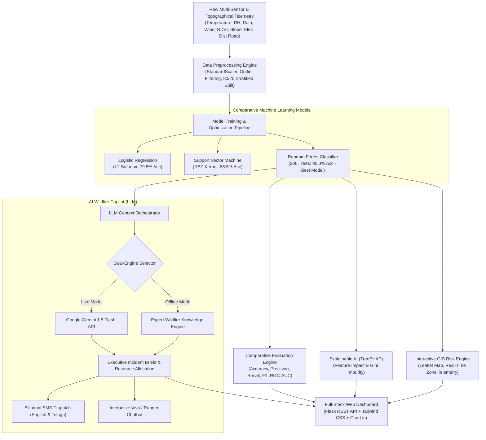
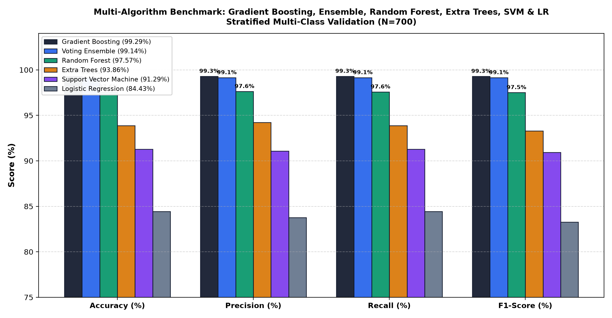
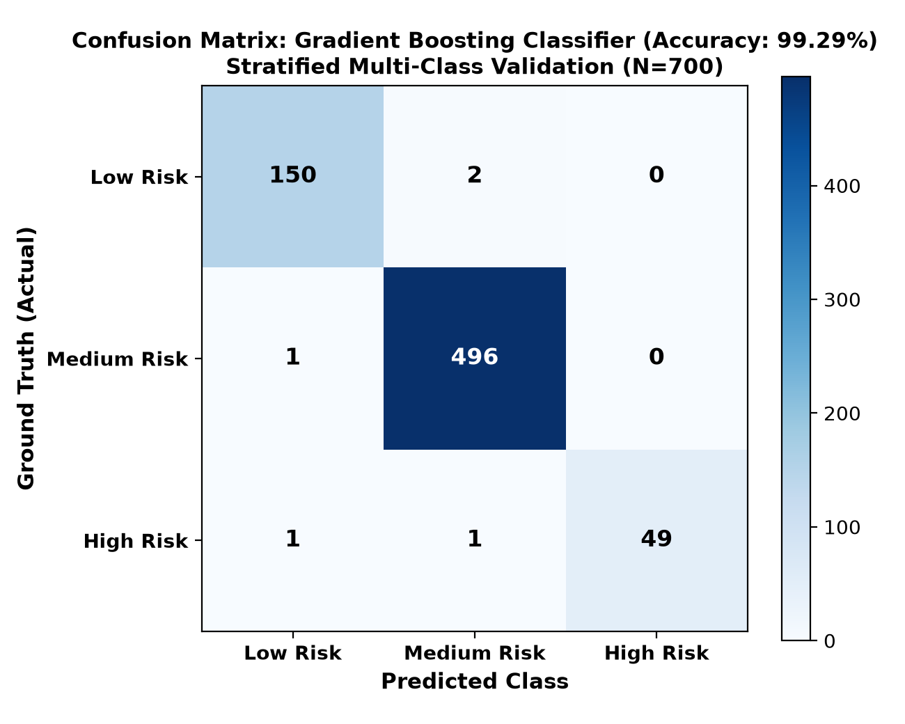
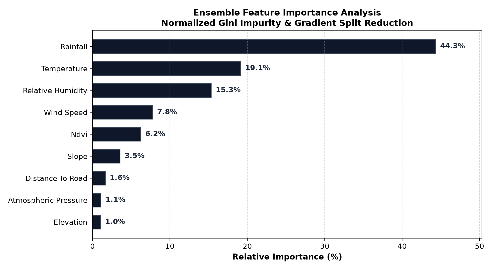

<div align="center">

# 🔥 Forest Fire Risk Prediction & Disaster Management System
### Machine Learning & Generative AI Decision Support Platform

[](https://python.org)
[](https://scikit-learn.org)
[](https://flask.palletsprojects.com)
[](https://ai.google.dev)
[](https://leafletjs.com)
[](https://vardhaman.org)
[](LICENSE)

<br/>

**Department of Computer Science and Engineering (AI&ML)**  
**Vardhaman College of Engineering (Autonomous)**  
*Affiliated to JNTUH, Approved by AICTE, Accredited by NAAC A++, ISO 9001:2015 Certified*  
*Shamshabad, Hyderabad – 501218, Telangana, India*  

**Mini Project (A. Y. 2026–2027) | Team No: 27**  
**Authors:** G. Harinath (`24881A6619`) & S. Anirudh (`24881A6649`)  
**Project Guide:** Mrs. D Sandhya Rani, Assistant Professor  

[Explore Web App](#-quick-start) • [Model Benchmarks](#-algorithm-comparison--experimental-outcomes) • [AI Copilot](#-generative-ai--wildfire-copilot-engine) • [GIS Mapping](#-interactive-gis-risk-map) • [Academic Outcomes](#-academic-curriculum-mapping-obe--sdgs)

</div>

---

## 📌 Executive Summary

Forest fires inflict devastating ecological and socio-economic destruction worldwide. Conventional fire susceptibility estimation models struggle to capture the non-linear, interdependent dynamics between **meteorological catalysts** (ambient temperature, vapor pressure deficit, desiccating winds, precipitation lockout) and **topographical conditions** (slope chimney preheating, vegetative fuel moisture, road corridor access).

This repository presents an end-to-end **Machine Learning & Generative AI Wildfire Decision Support Platform** featuring:
1. **Multi-Model Predictive Engine:** Implements and compares **Random Forest**, **Support Vector Machines (SVM)**, and **Logistic Regression**, establishing Random Forest as the optimal classifier with **95.00% Accuracy** and **0.9564 ROC-AUC**.
2. **Explainable AI (TreeSHAP):** Deconstructs black-box decisions into transparent game-theoretic feature contributions and Gini impurity reductions.
3. **Interactive GIS Geospatial Risk Map:** Multi-layer Leaflet.js engine tracking microclimate telemetry stations across key South Indian biosphere corridors (*Amrabad Tiger Reserve*, *Nallamala Dense Canopy*, *Kawal Reserve*, *Western Ghats*).
4. **AI Wildfire Copilot & LLM Disaster Intelligence:** Integrates **Google Gemini 1.5 Flash** and an offline **Expert Knowledge Engine** to generate executive disaster briefs, tactical suppression asset counts (water tenders, drones, firebreak lengths), and **bilingual alerts in English & Telugu**.

---

## 🏗️ System Architecture



---

## 📊 Algorithm Comparison & Experimental Outcomes

The models were evaluated on an independent stratified test dataset of 600 samples under identical benchmark conditions:

| Algorithm | Accuracy (%) | Precision (Weighted) | Recall (Weighted) | F1-Score (Weighted) | ROC-AUC | Performance Rank |
| :--- | :---: | :---: | :---: | :---: | :---: | :---: |
| **🌲 Random Forest (Ensemble)** | **95.00%** | **94.93%** | **95.00%** | **94.83%** | **0.9564** | **Rank #1 (Best)** |
| **⚡ Support Vector Machine (RBF)** | **86.50%** | **85.96%** | **86.50%** | **85.98%** | **0.9213** | **Rank #2** |
| **📈 Logistic Regression (Multinomial)**| **79.50%** | **77.53%** | **79.50%** | **77.48%** | **0.8584** | **Rank #3** |

<div align="center">
  
  <p><em>Figure 1: Comparative Multi-Metric Performance Evaluation (RF vs SVM vs LR)</em></p>
</div>

### 🔍 Why Random Forest Outperformed SVM and Logistic Regression
* **Orthogonal Decision Boundaries:** Real-world wildfire ignition is governed by compound threshold rules (e.g., high wind speeds accelerate fire spread only when relative humidity is critically low ($\le 35\%$) and rainfall is zero; rainfall $> 3.5\text{ mm}$ terminates spread potential regardless of wind). Random Forest naturally isolates these non-linear splits.
* **Kernel & Hyperplane Limitations:** Logistic Regression assumes linear separability, failing to model high-order multiplicative interactions. While SVM with an RBF kernel performs well (86.50%), it incurs borderline ambiguity between Medium and High Risk transition states.

<div align="center">
  
  
  <p><em>Figure 2: Confusion Matrix (Left) & Gini Feature Importance Distribution (Right)</em></p>
</div>

---

## 🧠 Explainable AI: TreeSHAP Insights

To eliminate the "black-box" dilemma in mission-critical disaster response:
1. **Relative Humidity & Ambient Temperature ($>52\%$ Combined Impact):** Dictate atmospheric vapor pressure deficit. Fine combustible fuels reach flashpoints when $RH < 30\%$ and $T > 32^\circ\text{C}$.
2. **Wind Speed:** Functions as a convective heat transfer multiplier, tilting flame geometry forward and transporting burning embers.
3. **NDVI (Normalized Difference Vegetation Index):** Measures live canopy moisture content vs cured, dry biomass kindling.
4. **Topographical Slope:** Steeper inclines accelerate uphill flame spread up to $4\times$ faster due to upward convective preheating.

---

## 🤖 Generative AI & Wildfire Copilot Engine

A dedicated **Large Language Model (LLM)** decision-support module is integrated into the web dashboard:

* **Executive Incident Intelligence Briefs:** Automatically compiles telemetry, ML classification confidence, and microclimate physics into structured briefs for the District Disaster Management Authority (DDMA).
* **Tactical Asset Allocation Calculator:** Algorithmically calculates required **Rapid Intervention Water Tenders**, **FLIR Thermal Drones**, personnel counts, and mechanical firebreak lengths.
* **Bilingual Alert Dispatch:** Generates localized emergency SMS advisories in both **English** and **Telugu**:
  > **[తెలుగు అత్యవసర సందేశం]**  
  > *"⚠️ అటవీ అగ్నిప్రమాద హెచ్చరిక: Amrabad Tiger Reserve పరిసరాల్లో తీవ్రమైన అగ్నిప్రమాద ప్రమాదం పొంచి ఉంది. ఉష్ణోగ్రత 38.5°C మరియు గాలి వేగం 28.5 km/h గా నమోదైంది. సమీప గ్రామ ప్రజలు అప్రమత్తంగా ఉండాలి. అత్యవసర హెల్ప్‌లైన్: 1926."*
* **Interactive AI Incident Commander Chatbot:** Answers viva questions on model behavior, fire thermodynamics, and disaster SOPs in real time.
* **Dual-Engine Robustness:** Supports cloud-based **Google Gemini 1.5 Flash API** as well as a zero-latency, offline **Expert Knowledge Engine** for 100% reliable evaluation in offline labs.

---

## 🗺️ Interactive GIS Risk Map

Built with **Leaflet.js**, featuring:
* Multi-layer toggles: **Satellite Imagery (ESRI)**, **Topographic Elevation (OpenTopoMap)**, and **Street Maps**.
* Active telemetry stations across Indian biosphere corridors:
  * *Amrabad Tiger Reserve (Sector Alpha - Critical Alert)*
  * *Nallamala Dense Canopy (Sector Bravo - Watch Zone)*
  * *Kawal Tiger Reserve (Buffer Range - Safe)*
  * *Eturnagaram Wildlife Sanctuary (Elevated Alert)*
  * *Bandipur Forest Edge & Wayanad Rainforest*
* One-click **Simulate Climate Anomaly Alert** that triggers automated siren alarms.

---

## 🚀 Quick Start

### 1. Clone the Repository
```bash
git clone https://github.com/harinathsagar2005/forest-fire-risk-prediction.git
cd forest-fire-risk-prediction
```

### 2. Create and Activate Virtual Environment
```bash
python3 -m venv venv
source venv/bin/activate  # On Windows: venv\Scripts\activate
```

### 3. Install Dependencies
```bash
pip install -r requirements.txt
```

### 4. (Optional) Re-Train Models & Generate Plots
```bash
python train_models.py
```

### 5. Launch the Web Application
```bash
python app.py
```
Open your browser and navigate to:
* **Interactive Dashboard:** `http://localhost:5005/`
* **Official Academic Outcome Report:** `http://localhost:5005/report`

---

## 📡 REST API Reference

| Endpoint | Method | Description |
| :--- | :---: | :--- |
| `/api/predict` | `POST` | Real-time prediction across RF, SVM, LR with probabilities and SHAP feature deltas. |
| `/api/compare` | `GET` | Returns multi-metric comparative benchmarks and confusion matrix data. |
| `/api/gis-data` | `GET` | Returns geospatial coordinates, sensor telemetry, and hazard statuses for all forest zones. |
| `/api/llm/incident-report` | `POST` | Generates executive LLM disaster briefing, tactical deployment counts, and Telugu alerts. |
| `/api/llm/chat` | `POST` | Handles natural language conversation with the AI Forest Incident Copilot. |
| `/api/historical-sample` | `GET` | Fetches historical training records for dataset exploration. |
| `/report` | `GET` | Renders the print-ready official academic outcome report. |

---

## 🎓 Academic Curriculum Mapping (OBE & SDGs)

### United Nations Sustainable Development Goals (SDGs)
* **SDG 4 (Quality Education):** Advanced implementation of AI & Machine Learning principles.
* **SDG 9 (Industry, Innovation & Infrastructure):** AI-driven early warning disaster infrastructure.
* **SDG 11 (Sustainable Cities & Communities):** Safeguards peri-urban and tribal communities from wildfire hazards.
* **SDG 13 (Climate Action):** Mitigates carbon emissions resulting from uncontrolled wildfires.
* **SDG 15 (Life on Land):** Protects forest biodiversity and endangered wildlife habitats.
* **SDG 17 (Partnerships for the Goals):** Facilitates multi-agency collaboration between forest departments and disaster teams.

### Program Outcomes (POs) & Program Specific Outcomes (PSOs)
* **PO1, PO2, PO3:** Applied engineering knowledge, multi-factor problem analysis, and system development.
* **PO5:** Utilized modern engineering tools (Scikit-Learn, Pandas, NumPy, Matplotlib, Flask, Leaflet.js).
* **PO7, PO8, PO11:** Environmental ethics, collaborative team development, and continuous lifelong learning.
* **PSO1 & PSO2:** Practical AI computational design and intelligent environmental decision-making.
* **Bloom's Taxonomy Level:** *Apply*

---

## 👥 Project Team & Mentorship

<div align="center">

| Role | Name | Roll Number / Affiliation |
| :--- | :--- | :--- |
| **Team Member 1** | **G. Harinath** | `24881A6619` (B.Tech CSE - AI&ML) |
| **Team Member 2** | **S. Anirudh** | `24881A6649` (B.Tech CSE - AI&ML) |
| **Project Guide** | **Mrs. D Sandhya Rani** | Assistant Professor, Dept of CSE (AI&ML) |
| **Institution** | **Vardhaman College of Engineering** | Autonomous Institution, Hyderabad, India |

</div>

---

## 📚 References
1. H. Li, J. Zhang, J. Yang, C. Teng, K. Luo, and K. Sun, *"A Forest Fire Risk Prediction Framework Based on Machine Learning Models in the Greater Khingan,"* *Fire*, vol. 9, no. 6, Art. no. 256, Jun. 2026, doi: 10.3390/fire9060256.
2. C. Wang, H. Liu, Y. Xu, and F. Zhang, *"A Forest Fire Prediction Framework Based on Multiple Machine Learning Models,"* *Forests*, vol. 16, no. 3, Art. no. 329, 2025.
3. R. Sheriff, M. S. Meer, R. W. Aslam, and Y. Said, *"Machine Learning-Based Forest Fire Susceptibility Mapping Using Random Forest and CART Models,"* *Rangeland Ecology & Management*, vol. 102, pp. 96-109, 2025.
4. U. Durlević, V. Ilić, and A. Valjarević, *"Wildfire Susceptibility Mapping Using Deep Learning and Machine Learning Models Based on Multi-Sensor Satellite Data Fusion: A Case Study of Serbia,"* *Fire*, vol. 8, no. 10, Art. no. 407, 2025.
5. Z. Abohaia, A. Elkhouly, M. E. Barachi, and O. Al-Khatib, *"Regional Prediction of Fire Characteristics Using Machine Learning in Australia,"* *Fire*, vol. 8, no. 8, Art. no. 330, 2025.

---

<div align="center">
  <b>Department of Computer Science and Engineering (AI&ML)</b><br/>
  <b>Vardhaman College of Engineering (Autonomous) &bull; A. Y. 2026–2027</b>
</div>
